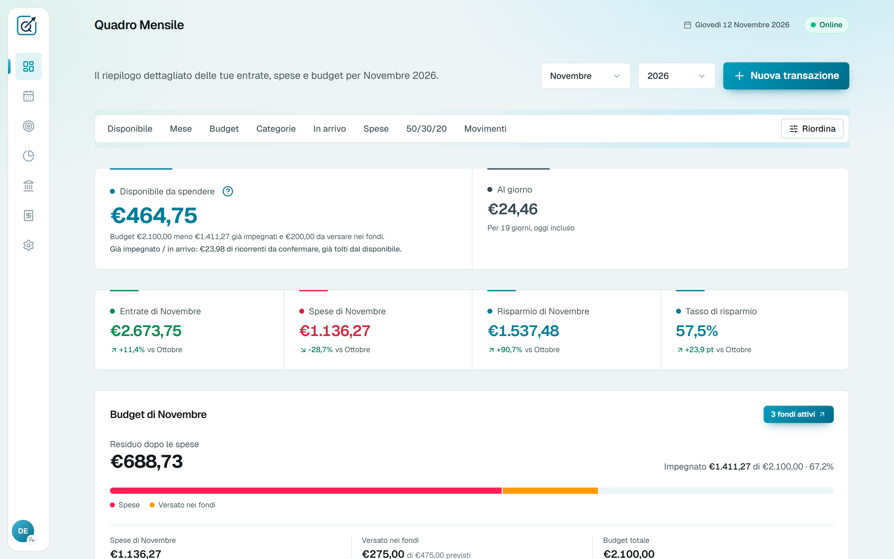
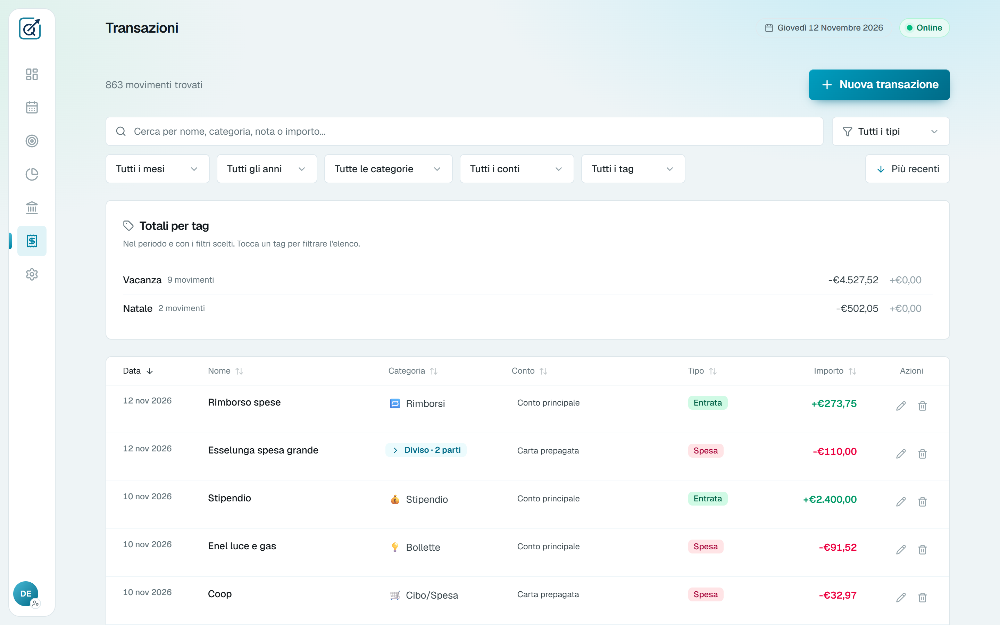
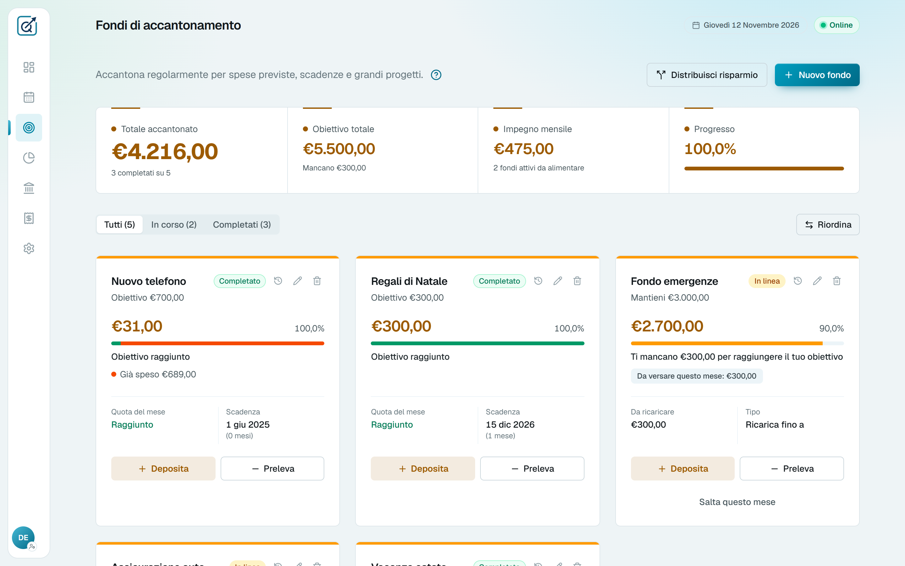
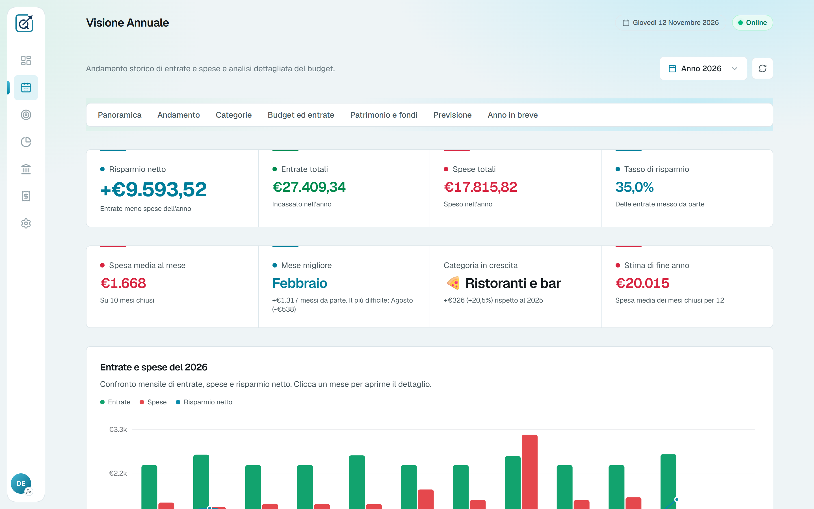
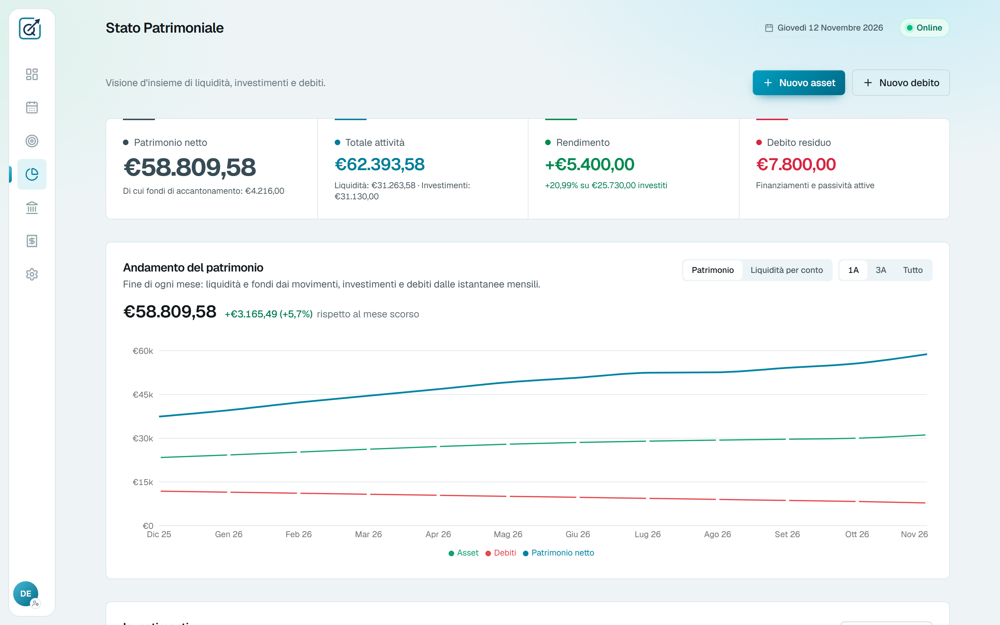
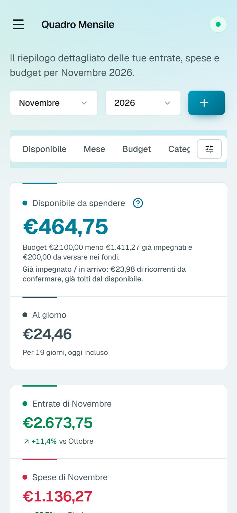
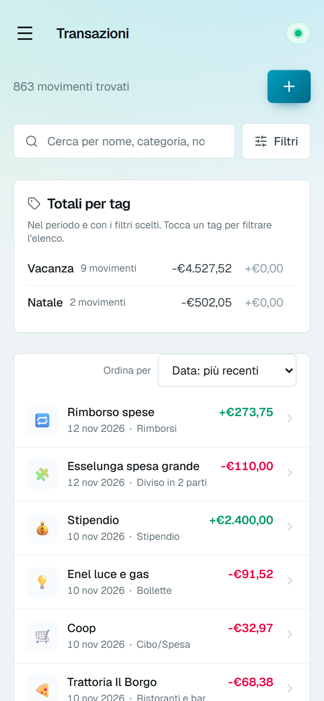
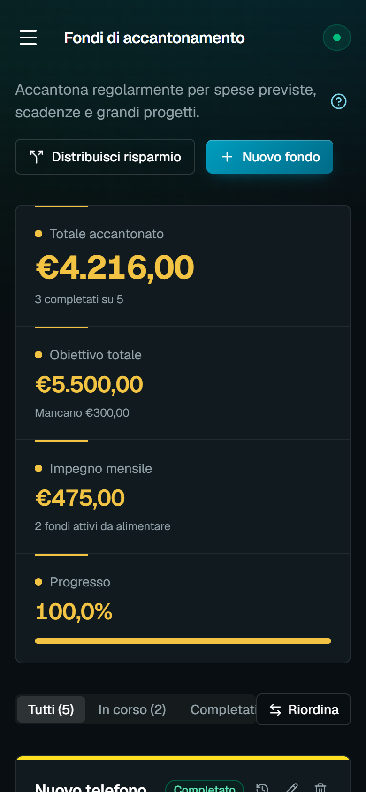
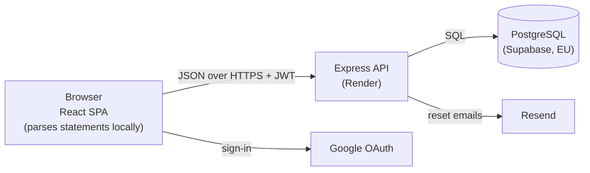

# Quadra

**A personal finance analytics app for people living in Italy: it turns bank movements into a monthly budget, savings
KPIs, goal tracking, net worth history and a cash-flow forecast, fully in Italian.**

**Live app: [quadra-conti.vercel.app](https://quadra-conti.vercel.app)** · Designed and built by **Riccardo Benassi**, October-November 2026

> This repository is a showcase: the screenshots and an overview of the project. The source code is private and
> available on request.

  

| Transactions                                                                | Sinking funds                                                           |
| --------------------------------------------------------------------------- | ----------------------------------------------------------------------- |
|  |  |
| **Annual view**                                                             | **Net worth**                                                           |
|  |                    |

  
  
  

More: [accounts](screenshots/accounts.png), [dashboard in dark mode](screenshots/dashboard-dark.png),
[annual view in dark mode](screenshots/annual-review-dark.png). All screenshots use a demo account with generated data.

Quadra ("fai quadrare il tuo budget", make your budget add up) answers one daily question, _how much can I still spend
this month?_, and the long-term ones behind it: am I saving enough, are my goals on track, how is my net worth moving.

---

## Why it exists

Budgeting apps either cover budgeting well (YNAB) or net worth well (Finary), are mostly in English, cost $95-$109 a
year, and rarely understand Italian banks and number formats. Quadra started from a competitor review (YNAB, Monarch,
Copilot, Finary, Wallet) that became the product roadmap. The niche it targets:

- **Italian first:** Italian UI, `1.234,56` amounts, DD/MM/YYYY dates, Italian banks' statement layouts.
- **One number to act on:** the dashboard opens with "Disponibile da spendere" instead of four equal charts.
- **Sinking funds with planned vs actual**, plus a real balance sheet (quantity and average buy price per asset).
- **Less typing:** recurring transactions, categorisation rules and statement import, the main reasons people abandon
  trackers being manual entry and maintenance.

## What it does

| Area                        | Highlights                                                                                                                                                                                              |
| --------------------------- | ------------------------------------------------------------------------------------------------------------------------------------------------------------------------------------------------------- |
| **Quadro Mensile**          | "Disponibile da spendere" hero number (holds back recurring items still to confirm), savings rate, 50/30/20 split, category budgets with month-to-month rollover, upcoming items, a reorderable layout. |
| **Transazioni**             | Search (including Italian-format amounts), filters, inline notes, tags with totals, split transactions across categories with cents-exact arithmetic, quick math in every amount field (`12,50+8`).     |
| **Conti** (accounts)        | Current, cash, prepaid and savings accounts; balances computed from movements; transfers; "Aggiorna saldo" reconciliation.                                                                              |
| **Fondi di accantonamento** | Three goal types (by date, fixed monthly, refill), health chips and catch-up amount, "Distribuisci risparmio" to split savings across funds, paying expenses straight from a fund.                      |
| **Stato Patrimoniale**      | Assets with quantity and average buy price, debts, net worth history chart (1Y / 3Y / all, per-account liquidity).                                                                                      |
| **Visione Annuale**         | Year-to-date vs the same stretch of last year, category heatmap, best/worst month, cash-flow forecast with scenarios, "Il tuo anno in breve" year review exported as an image.                          |
| **Automation**              | Recurring rules with confirm/skip, categorisation rules ("if the description contains X, then category Y"), bank-statement import with a review step.                                                   |
| **Your data**               | JSON backup and Italian CSV export, account deletion that removes everything, email/password or Google sign-in, password reset by email.                                                                |
| **Everywhere**              | Dark mode, phone layout (drawer navigation, bottom-sheet dialogs, compact lists), in-app guides, motion that respects `prefers-reduced-motion`.                                                         |

## Data and analytics

The part of the project closest to my data work: getting messy financial data in, defining the metrics, and making
every figure in the app agree with every other.

- **Data ingestion from bank statements.** PDF, CSV and Excel exports are turned into one clean movement table:
  automatic detection of delimiters, header rows and Italian vs English number and date formats, a column mapping
  remembered per account, and dedicated parsers for Allianz Bank PDFs that rebuild rows from positioned text. When a
  statement prints its opening and closing balances, the parsed rows are checked against them, so a missed line shows.
- **Data quality before anything is counted.** Duplicate movements are caught with per-movement fingerprints (date,
  amount, type and a hash of the normalized description), so importing the same file twice adds nothing. Transfers
  between your own accounts are paired (opposite sign, same amount, within 3 days) so money is never counted twice.
  Every imported row waits in a review list before it becomes a transaction.
- **Categorisation.** User-defined rules (contains / starts with / equals, optional account and amount range, ordered by
  priority) run first; when none matches, the category is suggested from the history of similar past descriptions.
- **One definition per metric.** Income, expenses and savings rate exclude internal moves (transfers, money set aside
  in funds) everywhere; net worth has a single formula (account liquidity + assets + fund balances - debts); split
  transactions count once, through their parts.
- **Honest comparisons.** The year in progress is compared with the same stretch of the previous year, up to today's
  date, never with a full year. Averages and the year-end estimate use closed months only (the estimate needs at least
  two).
- **Net worth over time.** One point per month: liquidity and fund balances recomputed from the movements at each month
  end, assets and debts from monthly snapshots, and the current month from live data so the chart's last point equals
  the headline figure.
- **Cash-flow forecast.** Month-by-month liquidity built from the open recurring items, the contributions goals still
  need, debt payments and the average of non-recurring flows over the last closed months, with switches for each
  component and what-if scenarios (a one-off expense, an income change).

## Tech stack

| Layer    | Technology                                                                                                                    | Hosting  |
| -------- | ----------------------------------------------------------------------------------------------------------------------------- | -------- |
| Frontend | React 19, TypeScript, Vite 8, Tailwind CSS 4, Zustand, Recharts, date-fns, lucide-react, pdf.js, read-excel-file              | Vercel   |
| Backend  | Node.js (ESM), Express 5, JWT, bcrypt, Google OAuth, helmet, express-rate-limit, Resend (email)                               | Render   |
| Database | PostgreSQL (Supabase, EU region), 19 versioned migrations; embedded PGlite (Postgres in WebAssembly) for local work and tests | Supabase |
| Quality  | Vitest, supertest, ESLint, Prettier, Vercel preview deployment on every pull request                                          |          |

## Engineering highlights

- **Privacy-by-design statement import.** PDF, CSV and XLSX files are parsed in the browser and never uploaded. Only
  normalized fields reach the server, after IBANs, card numbers, codici fiscali and long reference numbers are scrubbed,
  and the database runs in the EU.
- **One SQL code path, two engines.** The same plain-Postgres SQL runs on Supabase in production and on embedded
  PGlite locally, so the 600+ automated tests (unit tests for the pure logic, API tests with supertest) hit real
  Postgres behaviour without Docker or a shared database.
- **Safe schema evolution.** Versioned migrations run at server start, each in its own transaction, and a test migrates
  a database shaped like the old production schema.
- **Money correctness.** Split transactions follow one counting rule (the parts count, the container never does), so a
  movement is counted once in every total, budget, chart and balance. Fund totals change in the same database
  transaction as their movements, and bulk operations (import confirm, savings allocation) are all-or-nothing.
- **Security.** bcrypt passwords, JWTs carrying a token version so a password change logs out every other session, rate
  limits on authentication, helmet and a strict Content-Security-Policy, Google token audience checks, row-level
  security on every table with the database's public REST API blocked, hashed single-use password-reset tokens, and
  per-user access control on the import, enforced on the server.
- **Frontend performance and accessibility.** Lazy-loaded pages, store selectors that avoid needless re-renders,
  responses that patch the store in place instead of reloading everything, accessible dialogs (focus trap, Escape,
  labelled fields) and 44 px touch targets.

## How it was built

- **Product first:** competitor research turned into a phased roadmap (21 items, 16 shipped), and each item shipped on
  its own branch and pull request, with a dated changelog of what reached production.
- **AI-assisted development:** built with AI coding agents (Claude Code, Antigravity) under my direction. I owned the
  product decisions, the architecture, the data model and the metric definitions, reviewed every change, and kept the codebase conventions in a
  project guide the agents follow.
- **In numbers** (as of November 2026): about 32,000 lines of TypeScript and JavaScript, 89 React components, 36 pure
  logic modules, 626 automated tests in 43 files, 244 commits and 69 merged pull requests in about five weeks.

## Roadmap

Next items: an installable mobile app (PWA) with quick-add, AI-assisted categorisation and a "Chiedi a Quadra"
assistant, a shared household budget, and automatic bank sync through PSD2.

## Contact

Riccardo Benassi · [LinkedIn](https://www.linkedin.com/in/riccardo-benassi-5a444a446) · [GitHub](https://github.com/Benassi-Riccardo)
